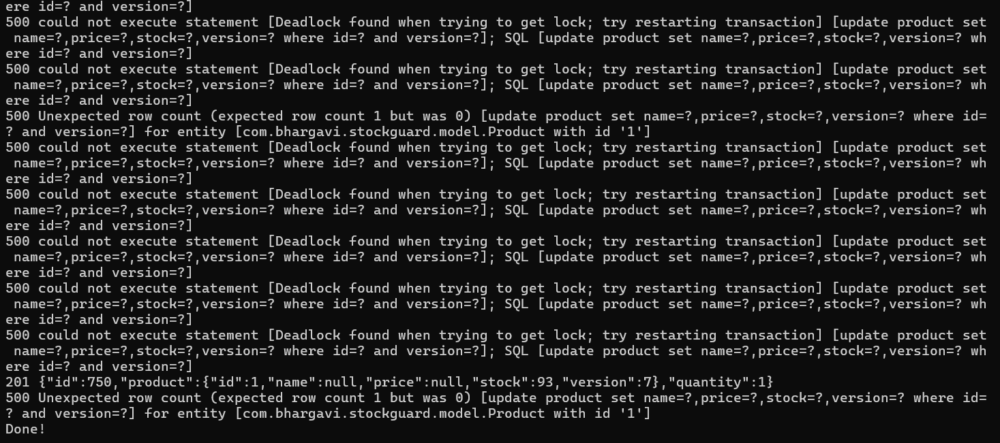
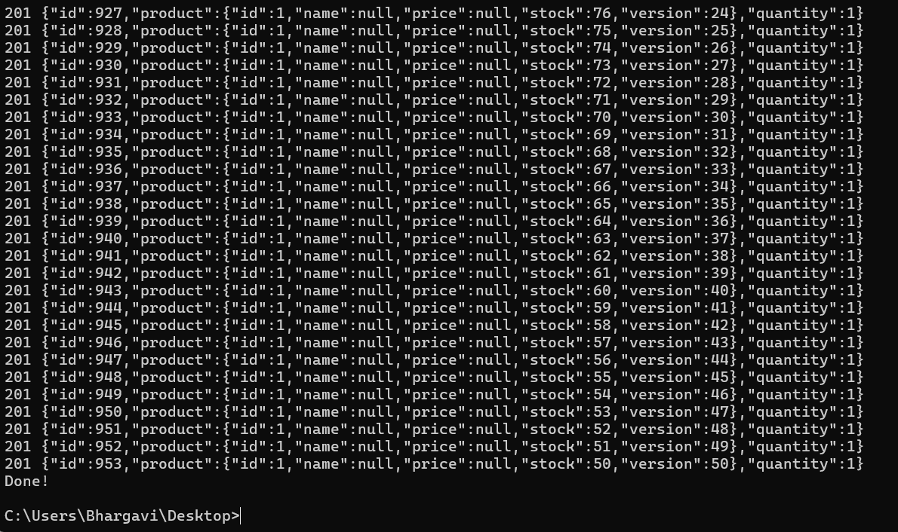
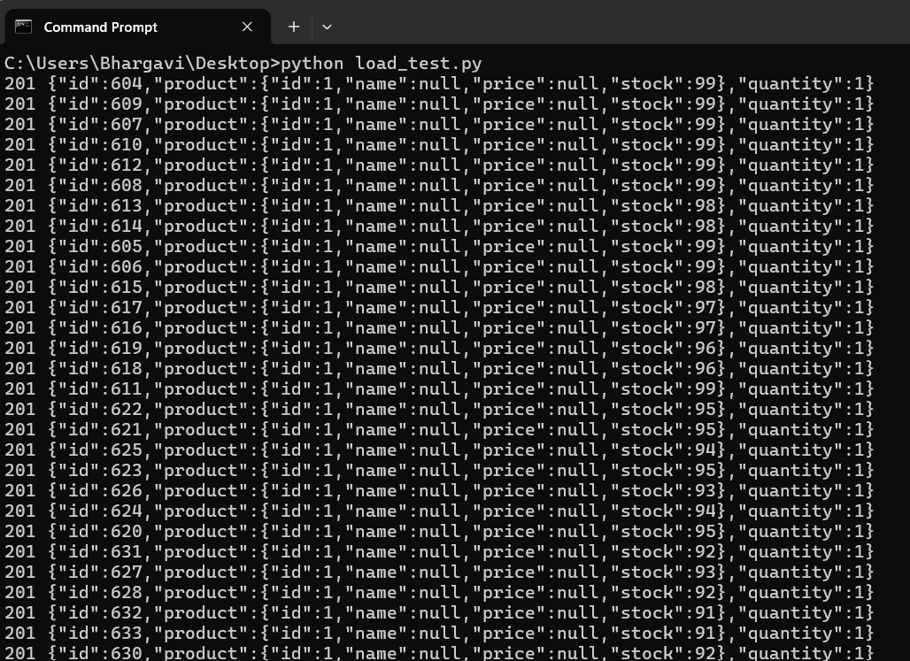

# StockGuard

An e-commerce inventory backend built with Spring Boot and MySQL, focused on one problem: **keeping stock correct when many customers order at the same time.**

I reproduced a real race condition (overselling), proved it with a concurrent load test, and fixed it two different ways: **optimistic locking** and **pessimistic locking**. Then I compared the results.

---

## The problem: lost updates

Placing an order does three steps: read the stock, subtract the quantity, write it back. When two requests run at the same time, they can both read the same value:

```
Thread A reads stock = 100
Thread B reads stock = 100        <- same stale value
Thread A writes 99
Thread B writes 99                <- overwrites A's update
```

Two orders were confirmed, but stock dropped by only 1. This is called a **lost update**, and it causes **overselling**: customers get confirmations for items that are no longer in stock.

## Results

All tests: local MySQL, a Python script firing **50 concurrent** `POST /orders` requests (quantity = 1) at one product with stock = 100, unless stated otherwise.

| Strategy | Orders created | Requests failed | Final stock | Correct? |
|---|---|---|---|---|
| No locking | 50 | 0 | 95 (should be 50) | No, 45 units oversold |
| Optimistic (`@Version`) | 7 | 43 (HTTP 500: version conflicts and deadlocks) | 93 (matches the 7 orders) | Yes, but most requests rejected |
| Pessimistic (`@Lock`) | 50 | 0 | 50 | Yes |

**Out-of-stock check (pessimistic locking):** stock = 20, 50 concurrent orders gives exactly **20 × 201 Created** and **30 × 400 Not enough stock**. Final stock = 0, never negative.


!


## How each approach works

### 1. No locking (the bug)
Plain `findById`, subtract, `save`. Fast, but incorrect under concurrency.

### 2. Optimistic locking
A `@Version` field on `Product`. Hibernate adds the version to every update:

```sql
UPDATE product SET stock=?, version=? WHERE id=? AND version=?
```

If another request changed the row first, the version no longer matches, zero rows are updated, and the request fails with `Unexpected row count`. No locks are held, so reads never wait, but the losing requests must be retried by the client.

```java
@Version
private Integer version;
```

### 3. Pessimistic locking
The product row is locked with `SELECT ... FOR UPDATE` inside a transaction. Other requests wait for the lock instead of conflicting.

```java
@Lock(LockModeType.PESSIMISTIC_WRITE)
@Query("SELECT p FROM Product p WHERE p.id = :id")
Optional<Product> findByIdWithLock(@Param("id") Long id);
```

```java
@Transactional
public Order placeOrder(Long productId, Integer quantity) {
    Product product = productRepo.findByIdWithLock(productId)
            .orElseThrow(() -> new RuntimeException("Product not found"));
    if (product.getStock() < quantity) {
        throw new RuntimeException("Not enough stock");
    }
    product.setStock(product.getStock() - quantity);
    productRepo.save(product);
    // ... create and save the Order
}
```

The lock only lasts for the duration of the transaction, so `@Transactional` is required.

## Optimistic vs pessimistic: when to use which

| | Optimistic | Pessimistic |
|---|---|---|
| Locks rows while working | No | Yes |
| On conflict | Reject, caller retries | Wait in line |
| Best when | Conflicts are rare | Conflicts are frequent |
| Example | A user editing their own profile | The last units of a flash-sale item |
| Cost | Failed requests and retries | Waiting, and a higher deadlock risk |

## A note on deadlocks

In the optimistic run, many requests failed with `Deadlock found when trying to get lock; try restarting transaction`. Several transactions read the product row without an exclusive lock, then each needed an exclusive lock to update it, while holding shared locks taken by the foreign-key check on the order insert. MySQL resolves this by killing one transaction.

Pessimistic locking avoids this, because the first thing each transaction does is take the exclusive lock, so the others queue up before holding anything.

## Tech stack

- Java, Spring Boot 4, Spring Data JPA (Hibernate)
- MySQL
- Python (`requests`, `threading`) for the load test

## API

| Method | Endpoint | Description |
|---|---|---|
| POST | `/products` | Add a product (`name`, `stock`, `price`) |
| GET | `/products` | List all products |
| GET | `/products/{id}` | Get one product |
| POST | `/orders?productId=1&quantity=1` | Place an order (reduces stock) |
| GET | `/orders/{id}` | Get one order |

Responses: `201` created, `400` not enough stock, `404` product not found.

## Project structure

```
src/main/java/com/bhargavi/stockguard/
  controller/   ProductController, OrderController
  service/      ProductService, OrderService
  repo/         ProductRepo, OrderRepo
  model/        Product, Order
  exception/    GlobalExceptionHandler
scripts/
  load_test.py
```

## Run it locally

1. Create the database in MySQL: `CREATE DATABASE stockguard;`
2. Set your database password as an environment variable (it is never stored in the code):
    - Windows (cmd): `set DB_PASSWORD=your_password`
    - macOS/Linux: `export DB_PASSWORD=your_password`
3. Start the app: `./mvnw spring-boot:run`
4. Add a product with stock 100:
   ```
   POST http://localhost:8080/products
   {"name": "Test product", "stock": 100, "price": 99.0}
   ```
5. Run the load test:
   ```
   pip install requests
   python scripts/load_test.py
   ```
6. Check the result: `SELECT stock, version FROM product WHERE id = 1;`

To reset between runs: `UPDATE product SET stock = 100, version = 0 WHERE id = 1;`

## What I learned

- A race condition can be invisible in normal testing, and only a concurrent load test shows it.
- Silent data corruption (overselling) is worse than a visible failure.
- Optimistic and pessimistic locking trade failures against waiting, and the right choice depends on how often requests collide.
- `@Lock` needs `@Transactional`, or the lock is released immediately.
- When a fix changes nothing, check which code is actually running before changing more.

## Possible improvements

- Return `409 Conflict` for concurrency errors instead of a generic `500`
- Automatic retry for optimistic-lock failures
- Automated concurrency test (JUnit with parallel threads)
- Docker Compose setup for the app and MySQL
